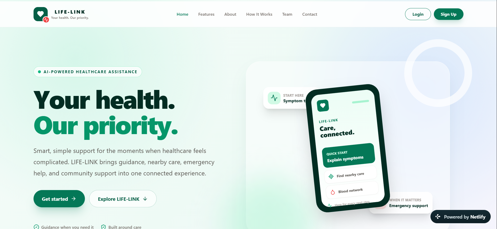
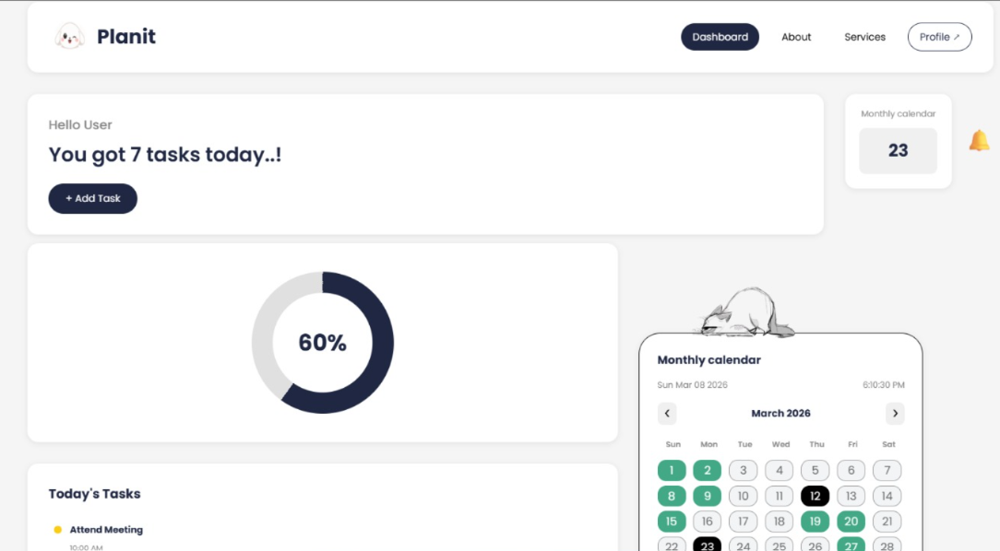
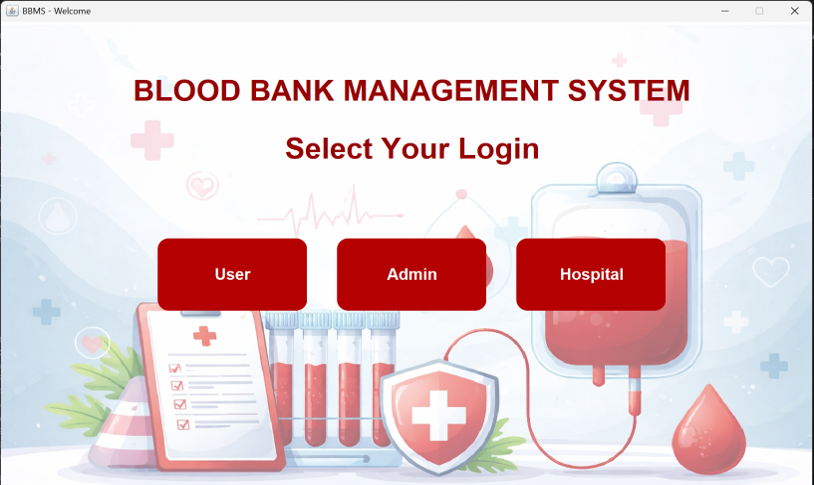

<!-- Top Banner -->

  

 

<!-- Connect With Me -->

  
  &nbsp;&nbsp;&nbsp;&nbsp;
  
  &nbsp;&nbsp;&nbsp;&nbsp;
  
  &nbsp;&nbsp;&nbsp;&nbsp;
  

 

<!-- About Me -->

## ABOUT ME

 

### *Hi, I'm Hansitha!*

I'm a **B.Tech Computer Science and Engineering (Data Science)** student with a strong interest in `Artificial Intelligence`, `Machine Learning`, and `Full Stack Development`.

I enjoy turning ideas into practical solutions by combining creativity, logical thinking, and technology. I'm particularly interested in exploring AI-powered applications, building interactive web experiences, and developing projects that solve real-world problems.

I'm always excited to learn new technologies, experiment with innovative ideas, and challenge myself to grow as a developer.

> *"My goal is to build technology that makes a meaningful difference."*

 

 

<!-- Tech Stack -->

## TECH STACK & TECHNOLOGIES

 

<b>PROGRAMMING LANGUAGES</b>

  
  &nbsp;&nbsp;&nbsp;&nbsp;
  
  &nbsp;&nbsp;&nbsp;&nbsp;
  
  &nbsp;&nbsp;&nbsp;&nbsp;
  
  &nbsp;&nbsp;&nbsp;&nbsp;
  
  &nbsp;&nbsp;&nbsp;&nbsp;
  
  &nbsp;&nbsp;&nbsp;&nbsp;
  

 

<b>AI / ML</b>

  
  &nbsp;&nbsp;&nbsp;&nbsp;
  
  &nbsp;&nbsp;&nbsp;&nbsp;
  
  &nbsp;&nbsp;&nbsp;&nbsp;
  
  &nbsp;&nbsp;&nbsp;&nbsp;
  
  &nbsp;&nbsp;&nbsp;&nbsp;
  

 

<b>WEB DEVELOPMENT</b>

  
  &nbsp;&nbsp;&nbsp;&nbsp;
  
  &nbsp;&nbsp;&nbsp;&nbsp;
  
  &nbsp;&nbsp;&nbsp;&nbsp;
  
  &nbsp;&nbsp;&nbsp;&nbsp;
  

 

<b>TOOLS</b>

  
  &nbsp;&nbsp;&nbsp;&nbsp;
  
  &nbsp;&nbsp;&nbsp;&nbsp;
  

<!-- GitHub Analytics -->

## GITHUB ANALYTICS

 

  

<table width="100%" align="center">
  <tr>
    <td width="50%" align="center" valign="middle">
      
    </td>
    <td width="50%" align="center" valign="middle">
      
    </td>
  </tr>
</table>

 

<!-- LeetCode Profile -->

## LEETCODE PROFILE

 

<!-- Featured Projects -->

## FEATURED PROJECTS

 

<table width="100%">
  <tr>
    <td width="33.33%" align="left" valign="top">
      
        
      <a href="https://lioralifelink.netlify.app/"><b>LIFE LINK</b></a> 
      <b>Multilingual Emergency Healthcare &amp; Triage Platform</b>
      

        
          LLM-powered triage, doctor chat &amp; hospital directory, plus emergency alerts and blood donor notifications.
        
      

      
    </td>
    <td width="33.33%" align="left" valign="top">
      
        
      <a href="https://github.com/Kuvendrahansithadevi/Planit"><b>Planit</b></a> 
      <b>MERN Stack Productivity Dashboard</b>
      

        
          Interactive full-stack web application for task and productivity management.
        
      

      
    </td>
    <td width="33.33%" align="left" valign="top">
      
        
      <a href="https://github.com/Kuvendrahansithadevi/BLOOD_BANK_MANAGEMENT_SYSTEM"><b>Blood Bank Management System</b></a> 
      <b>Java Swing + MySQL</b>
      

        
          Team-built blood bank management application using JDBC for database connectivity.
        
      

      
    </td>
  </tr>
</table>

